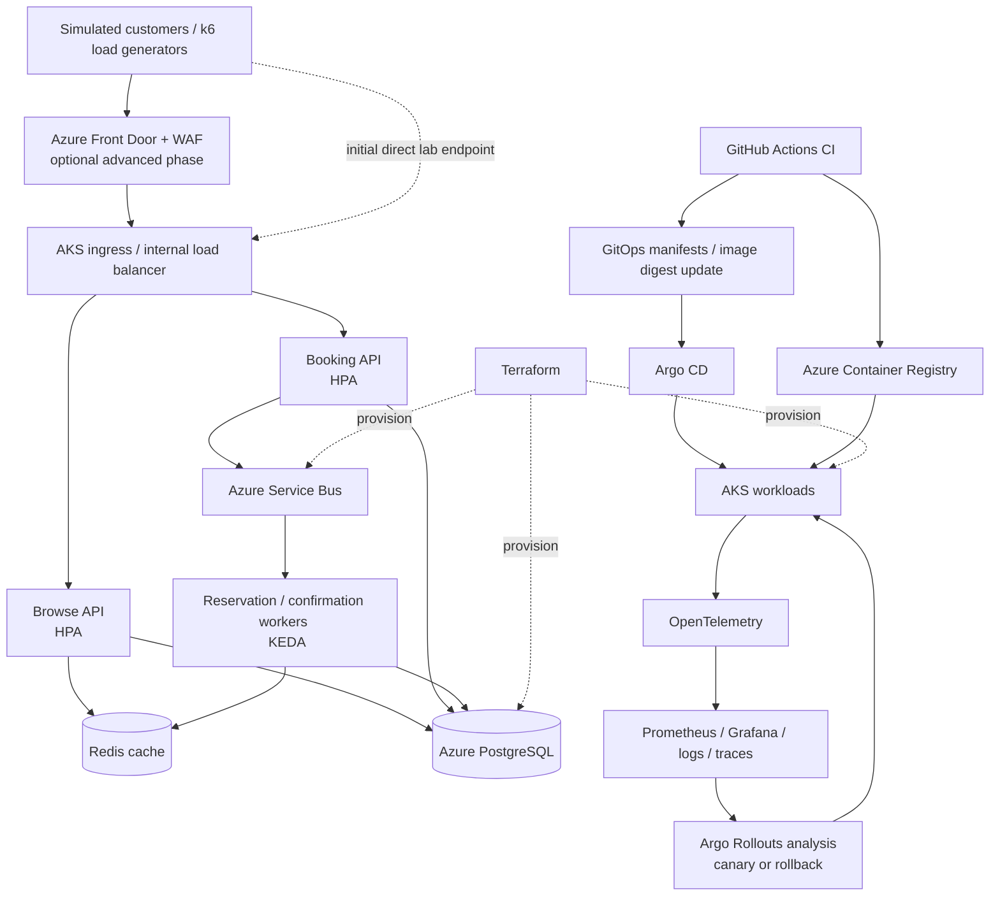

# Azure TrafficForge

## Local backend - first implementation

The local backend now includes separate Dockerized FastAPI browse and booking APIs,
PostgreSQL, a reservation-expiry worker, and PostgreSQL integration tests.
It supports general admission and assigned seats, atomic group reservations,
five-minute holds, idempotent creation, confirmation, and cancellation of active holds.
An optional Docker messaging profile adds Service Bus publishing, an idempotent
consumer, backlog metrics, and safe replay. See the [messaging setup](docs/messaging.md)
for the emulator license acceptance and start command.
GitHub Actions configuration adds container tests, workflow validation, a runtime
vulnerability gate, and SBOM evidence. See [CI setup and coverage](docs/ci.md), including
the separate license opt-in for broker tests on GitHub runners.

```powershell
docker compose up --build -d db browse booking expiry-worker
docker compose --profile test run --build --rm tests
```

Open the Browse API at http://localhost:8001/docs and Booking API at
http://localhost:8002/docs. See [local setup and examples](docs/local-development.md),
the [implemented design and API contract](docs/architecture.md), and the
[running work log](memeory.md).

This is a local correctness baseline. Identity is simulated, and Azure infrastructure
has not been implemented. The platform
architecture and phases below describe the broader target.

**Production-Grade High-Traffic, Self-Healing Platform on Microsoft Azure**

> **Level:** Advanced / Expert DevOps · **Cloud:** Microsoft Azure · **Focus:** Traffic engineering, Kubernetes, platform engineering, reliability, security and disaster recovery

## Overview

Azure TrafficForge is a portfolio-grade DevOps project that simulates the infrastructure behind a high-demand concert ticketing service. During a flash sale, thousands of users browse events, reserve tickets and submit bookings at once. The main engineering challenge is not the frontend: it is keeping the platform responsive, consistent, secure, observable and recoverable under load.

**Primary goal:** Build a reproducible Azure platform that can autoscale under traffic, tolerate component failures, safely roll back faulty releases, and recover from incidents—all demonstrated with repeatable experiments and measured evidence.

### Project targets (aspirational, not guaranteed)

| Metric | Target | Scope / qualification |
|---|---:|---|
| Peak throughput | **10,000 requests/second** | Stretch load-test goal; subject to Azure quota, budget and application design |
| p95 response latency | **< 300 ms** | Lightweight browse endpoint under an explicitly documented test load |
| Availability | **99.9%** | Target SLO; estimate from measured service indicators over a stated evaluation window |
| Application rollback | **< 2 minutes** | Measured from failed-release detection to recovered service |
| Inventory consistency | **Zero oversold tickets** | Verified under concurrent booking tests |

These numbers are **goals to investigate**, not promises or prevalidated benchmarks. Always publish the workload, concurrency, VM/node sizes, region, costs and actual results alongside any performance claim.

---

## 1. Problem statement and scenario

A concert organizer announces a major ticket sale. Normal traffic suddenly grows into a flash crowd. At the same time, some booking operations must be serialized or guarded with database transactions to avoid overselling inventory.

The platform must:

- Serve browse traffic quickly and scale API replicas as demand rises.
- Accept reservations without selling the same ticket twice.
- Process slow or asynchronous booking tasks through queues and workers.
- Absorb and recover from traffic spikes or worker backlogs.
- Detect errors, slowdowns and capacity issues with dashboards and alerts.
- Deploy updates safely with progressive rollouts and automated rollback.
- Resist basic security threats and prevent unauthorized secret access.
- Survive simulated pod/node outages and support verified data restore.
- Be provisioned and reproduced as code, with minimal manual portal steps.

**Non-goals at first:** building a full payment gateway, multi-environment infrastructure, or a production-ready public ticket marketplace. Payments should be simulated; no actual card data is required. Begin in **one Azure region and one lab environment**, then introduce advanced resilience features after the core platform works.

## 2. High-level architecture



**Architecture notes:** The diagram is conceptual. Terraform provisions Azure resources; Helm/manifests manage Kubernetes applications. Start with a simple ingress; add Front Door Premium, WAF, Private Link and private ingress only after confirming regional support and costs. Redis is a cache rather than the source of truth for ticket inventory. PostgreSQL enforces the reservation consistency rules.

### Core components

| Layer | Technology | Purpose |
|---|---|---|
| Infrastructure | Terraform | Azure networking, AKS, ACR, identities, database, messaging, remote state |
| Compute | AKS Standard, Docker | Kubernetes services, node pools, resource controls |
| Applications | FastAPI (example), lightweight frontend | Browse, reserve and process ticket orders |
| Ingress | Kubernetes ingress; optionally Azure Front Door + WAF | HTTPS entry point, routing, protection |
| CI/CD | GitHub Actions | Tests, scans, builds, signing, deployment updates |
| GitOps | Argo CD | Desired-state reconciliation from Git |
| Progressive delivery | Argo Rollouts | Canary releases, metric-driven rollback |
| Autoscaling | HPA, KEDA, AKS cluster autoscaler | Replica and node scaling against load |
| Messaging | Azure Service Bus | Asynchronous processing and dead-lettering |
| Data | Azure Database for PostgreSQL | Durable inventory, reservations and orders |
| Cache | Redis | Cache and optional rate-limiting data |
| Observability | OpenTelemetry, Prometheus, Grafana, logs, tracing | Metrics, traces, investigation, alerting |
| Security | Microsoft Entra Workload ID, Key Vault, Trivy, Kyverno | Identity, secrets, image scanning and policies |
| Testing | k6 | Baseline, stress, spike and soak tests |
| Resilience | LitmusChaos and/or Azure Chaos Studio | Controlled fault injection and recovery testing |

## 3. Application design and business rules

Implement a small application with three main backend components:

1. **Browse API:** list available concerts and ticket availability; supports caching and high read throughput.
2. **Booking API:** create reservations, enforce idempotency and inventory constraints, publish booking events.
3. **Worker:** consume Service Bus events, process simulated confirmations, retry transient failures and dead-letter poison messages.

Suggested endpoints:

| Endpoint | Purpose |
|---|---|
| `GET /healthz` | Liveness status |
| `GET /readyz` | Dependency-aware readiness |
| `GET /events` | Browse events |
| `GET /events/{id}/availability` | Read ticket availability |
| `POST /reservations` | Atomic reservation with idempotency key |
| `GET /reservations/{id}` | Reservation status |
| `POST /reservations/{id}/confirm` | Simulated confirmation |

Use database transactions and properly constrained updates to prevent overselling. Design reservation expiration and cancellation carefully. Do not treat Redis cache counters as authoritative inventory. Use idempotent consumers, bounded retries, dead-letter queues and an outbox-style event publication mechanism if reliable database-to-queue consistency is required.

**Correctness experiment:** Seed 100 tickets, generate 1,000 concurrent booking attempts, and assert that confirmed plus active reserved inventory never exceeds 100. Record failures, retry behavior, duplicate requests and processing lag.

## 4. Functional and non-functional requirements

### Functional

- [ ] Browse catalog and inventory through HTTP APIs.
- [ ] Reserve and confirm tickets without overselling.
- [ ] Publish booking events and process them asynchronously.
- [ ] Handle duplicate submissions through idempotency keys.
- [ ] Expire unconfirmed reservations safely.
- [ ] Provide useful health/readiness endpoints and structured logs.
- [ ] Expose metrics and traces for key operations.

### Reliability, operations and security

- [ ] Rebuild infrastructure from Terraform with no untracked manual steps.
- [ ] Deploy from Git through a reviewed, auditable CI/CD process.
- [ ] Enforce resource requests/limits, probes, disruption budgets and spread constraints.
- [ ] Scale stateless services and queue consumers automatically.
- [ ] Define measurable SLIs/SLOs and alert on meaningful degradation.
- [ ] Demonstrate a canary rollout and automatic rollback.
- [ ] Verify least-privilege service identities and pod-to-pod network restrictions.
- [ ] Run controlled chaos tests without affecting external systems.
- [ ] Test backups and restore with documented RTO and RPO.
- [ ] Track infrastructure and test costs, and clean up unused resources.

## 5. Implementation phases

### Phase 1 — Reproducible Azure foundation

**Build:** Terraform remote state, resource groups, Azure VNet/subnets, AKS Standard, separate system/user node pools, ACR, managed identities and role assignments, PostgreSQL, Service Bus, basic ingress and monitoring primitives.

**Learn:** Terraform modules, state locking/management, Kubernetes networking, node scheduling, Azure identity, networking boundaries and resource quotas.

**Experiment:** Tear down a disposable stack and recreate it using CI. Record deployment time and any manual intervention. **Be careful:** databases and other stateful resources require explicit backup/retention handling before destruction.

**Exit criteria:** Documented `terraform plan`/`apply`, a working cluster, private-access decisions, successfully pulled container images and a clean reproducibility report.

### Phase 2 — Traffic-ready application

**Build:** Containerized browse API, booking API, worker, PostgreSQL schemas, Redis caching and Service Bus queues. Add readiness probes and structured logs.

**Experiment:** Concurrently request 1,000 reservations for 100 tickets. Also test duplicate keys, worker retries and queue dead-letter behavior.

**Exit criteria:** No overselling; duplicates handled safely; observable request and queue outcomes.

### Phase 3 — Secure CI/CD and GitOps

**Build:** GitHub Actions tests; Trivy image and dependency scans; SBOM generation; immutable versioning by digest; optional image signing; Argo CD sync; Argo Rollouts canary steps of **5% → 25% → 50% → 100%**.

**Experiment:** Deploy a deliberately slower or error-prone version and use verified rollout analysis to abort/roll back. Ensure Git's desired state and the rollback strategy cannot continuously reintroduce the broken artifact.

**Exit criteria:** Traceable commit-to-cluster release, signed/scanned artifact evidence where implemented, and measured rollback duration.

### Phase 4 — Observability and SLOs

**Build:** OpenTelemetry traces, Prometheus metrics, Grafana dashboards, centrally searchable logs and actionable alert rules.

Instrument the **RED signals** (request rate, errors, duration), plus node CPU/memory, pod restarts, queue depth, worker lag, database saturation and dependency errors.

**Experiment:** Introduce a slow database query or limited connection pool; diagnose the latency regression through telemetry.

**Exit criteria:** Dashboard screenshots, trace examples, alert examples and a written root-cause walkthrough.

### Phase 5 — Autoscaling and traffic engineering

**Build:** HPA for APIs, KEDA for Service Bus workers, AKS node autoscaling, PodDisruptionBudgets, topology spread constraints and realistic requests/limits.

**Experiment:** Run baseline, ramp, flash-spike and recovery tests. Capture throughput, p50/p95/p99 latency, failures, pod counts, node counts and queue depth.

**Exit criteria:** Demonstrate automatic scale-out and scale-in and distinguish application scaling bottlenecks from database and quota limits.

### Phase 6 — Zero-trust-oriented hardening

**Build:** Microsoft Entra Workload ID, Key Vault access, GitHub OIDC to Azure, least-privilege Kubernetes and Azure RBAC, network policies, Kyverno policies and security scans.

**Experiment:** Attempt to access secrets or prohibited internal endpoints from an intentionally unprivileged test pod.

**Exit criteria:** Failed unauthorized access attempts, passing policy tests and documented trust boundaries. Never print real secrets in public logs or screenshots.

### Phase 7 — Chaos engineering and incident response

**Build:** Controlled experiments with pod termination, node drain, dependency network interruption, response delays and worker failures. Choose LitmusChaos or supported Azure Chaos Studio faults according to current availability.

**Experiment:** Inject failures while controlled load is running; measure time to detection, time to recovery, customer-visible errors and data consistency.

**Exit criteria:** An incident timeline, dashboards and a blameless postmortem for every major scenario. Stop conditions and cleanup must be defined before tests.

### Phase 8 — Disaster recovery and rebuild

**Build:** Backup policy, restore playbooks, immutable image retention, infrastructure rebuild instructions, database recovery verification and optional secondary-region expansion.

**Experiment:** Restore application service and a known data snapshot into a disposable recovery setup. Validate recovered reservations, data integrity and application health.

**Exit criteria:** Measured **RTO** (recovery time objective) and **RPO** (recovery point objective), evidence of restore, and a complete runbook.

## 6. Traffic and performance test plan

Use k6 locally first. For higher loads, use dedicated/distributed generators or a managed load-testing service and measure generator saturation independently from server saturation.

| Test | Illustrative load | What it reveals |
|---|---:|---|
| Smoke | 10–50 RPS | Functional correctness and baseline instrumentation |
| Baseline | 100 RPS | Normal latency, resource use, error rates |
| Ramp | 100 → 1,000 RPS | Initial scaling behavior and bottlenecks |
| Flash sale | 1,000 → 5,000 RPS | Burst capacity and cold-start lag |
| Extreme stretch | Up to 10,000 RPS | Capacity ceiling **only if quota and budget allow** |
| Soak | Moderate sustained load | Leaks, gradual saturation and stability |
| Failure during load | Controlled load + injected fault | Recovery, failover and error budget impact |

### Capacity calculation (illustrative only)

If a pod can sustainably serve `150 RPS` (measured in a real test) and you want 30% spare capacity:

```text
usable throughput per pod = 150 × (1 − 0.30) = 105 RPS
estimated replicas at 1,000 RPS = ceil(1000 / 105) = 10 pods
estimated replicas at 10,000 RPS = ceil(10000 / 105) = 96 pods
```

This simple sizing formula assumes roughly linear scalability, healthy downstream services and sufficient cluster capacity. It **does not** size Kubernetes nodes, PostgreSQL, message processing, ingress, networking or load generators. Replace the assumed per-pod throughput with observed results. Configure HPA/KEDA maximums and Azure quotas deliberately.

### Required benchmark report

For every test, record:

- Date/time, Azure region, active Azure SKUs and AKS node sizes/counts.
- Tool, scenario, virtual users, RPS, duration, request mix and dataset.
- p50/p95/p99 latency, throughput, HTTP error percentages and timeouts.
- Pod replicas, scaling event times, node utilization and database metrics.
- Service Bus backlog, processing rate, retries and dead-letter count.
- Costs for running the environment and the test, with assumptions.
- Unexpected failure modes, bottlenecks and engineering changes made.

## 7. Example demonstrations

1. **Traffic spike:** Raise request rate; show KEDA/HPA and cluster scale-out followed by a stable plateau and scale-in.
2. **No oversell:** Fire concurrent booking requests; show database invariants and a consistency test report.
3. **Bad release:** Deploy a version that increases 5xx errors or latency; show canary analysis rejecting it and application health recovering.
4. **Dependency slowdown:** Introduce latency; correlate a trace with DB metrics and app error budget impact.
5. **Least privilege:** Attempt unauthorized API/Key Vault access with a test identity and show policy-denied access.
6. **Node disruption:** Drain a node during test traffic and show rescheduling, disruption-budget effects and actual error rates.
7. **Recovery:** Restore a known database snapshot in a test environment, verify sample orders and report RTO/RPO.

Do not run disruptive tests on shared or customer infrastructure. Load test only endpoints you own or are authorized to test.

## 8. Repository layout

```text
azure-trafficforge/
├── apps/
│   ├── browse-api/
│   ├── booking-api/
│   ├── reservation-worker/
│   └── frontend/
├── infrastructure/
│   └── terraform/
│       ├── bootstrap/
│       ├── modules/
│       │   ├── network/
│       │   ├── aks/
│       │   ├── acr/
│       │   ├── database/
│       │   ├── redis/
│       │   ├── servicebus/
│       │   ├── identity/
│       │   └── ingress/
│       └── stacks/
│           ├── core/
│           └── addons/
├── kubernetes/
│   ├── base/
│   ├── helm/
│   ├── gitops/
│   ├── autoscaling/
│   ├── policies/
│   └── rollouts/
├── observability/
│   ├── dashboards/
│   ├── alert-rules/
│   ├── otel/
│   └── slo/
├── load-tests/
│   ├── baseline.js
│   ├── spike.js
│   ├── stress.js
│   └── soak.js
├── chaos/
│   ├── experiments/
│   └── results/
├── .github/
│   └── workflows/
│       ├── ci.yml
│       ├── terraform-plan.yml
│       ├── terraform-apply.yml
│       ├── release.yml
│       └── security.yml
├── docs/
│   ├── architecture.md
│   ├── security.md
│   ├── capacity-planning.md
│   ├── incidents/
│   ├── runbooks/
│   └── disaster-recovery.md
└── README.md
```

The repository layout is the **target design**, not a claim that the directories or services already exist.

## 9. Ten-week roadmap

| Week | Main deliverable | Proof of completion |
|---:|---|---|
| 1 | Terraform networking, state, identities and budget controls | Infrastructure plan and networking diagram |
| 2 | AKS node pools, ACR, ingress, basic deployments | Working container on AKS |
| 3 | Browse/booking APIs, PostgreSQL, Service Bus, worker | Concurrent reservation consistency test |
| 4 | GitHub Actions and Argo CD | End-to-end GitOps deployment |
| 5 | Argo Rollouts, canary metrics, rollback | Bad-release demo + rollback time |
| 6 | Telemetry and SLO dashboards | Trace and root-cause diagnosis |
| 7 | HPA/KEDA/node scaling + k6 scenarios | Load curves and scaling charts |
| 8 | Identity, secrets, network policies, scans | Security tests and least-privilege proof |
| 9 | Chaos experiments, incident drills | Incident reports and recovery timing |
| 10 | Backup restore, benchmark, cost evaluation | Final technical report and demo video |

Timelines are planning estimates, not guaranteed completion dates. Complete prerequisite phases before costly scale and resilience experiments.

## 10. Azure sponsorship, cost and safety

A sponsorship subscription can make a project like this feasible, but **confirm your own remaining credits, available regions, VM quotas and offer-specific spending restrictions** before deployment.

### Cost-conscious sequencing

- Start with a small single-region AKS lab; keep node-pool autoscaling maximums bounded.
- Use local/nonproduction Redis first; switch to a managed service when testing real availability requirements.
- Begin with local k6 rather than expensive distributed load generation.
- Reduce log volume and metrics retention; avoid high-cardinality labels.
- Add Front Door Premium, Private Link, advanced managed data SKUs and second-region resources only when the phase requires them.
- Schedule shutdown or destroy disposable resources between experiments; retain backups deliberately.
- Set Azure Cost Management budgets and notifications. **Budget alerts do not automatically impose a hard cost cap.**
- Document cleanup commands and keep a resource inventory to avoid leaving chargeable services running.

**Safety:** Use synthetic users and tickets. Never test against a third-party service without authorization; never include payment card data, real credentials or customer information.

## 11. Portfolio evidence and definition of done

The project is complete when there is objective, reproducible proof for each major capability:

- [ ] Reproducible Terraform deployment documented with state and networking design.
- [ ] Working API, queue workers and durable database with verified inventory consistency.
- [ ] GitHub Actions CI with test results, security scans, and traceable image artifacts.
- [ ] Argo CD reconciles cluster state from Git.
- [ ] Canary release rejects a measured bad deployment and restores service.
- [ ] Dashboards show request rate, errors, latency, scaling and queue processing.
- [ ] Autoscaling experiments include real load and before/after evidence.
- [ ] Least-privilege permissions and network policies have negative access tests.
- [ ] Chaos test findings include incident timelines and corrective actions.
- [ ] Backup restoration is successful with measured RTO and RPO.
- [ ] A final benchmark explains bottlenecks, scaling limits and cost/performance.
- [ ] Demo video shows load spike, scaling, bad release, rollback and recovery.

Suggested final artifacts: an architecture diagram, `docs/capacity-planning.md`, sample Grafana exports, k6 JSON/HTML outputs, release/runbook documentation, postmortems, security test results, a bill-of-materials/cost summary and a concise engineering case study.

### What makes this project stand out

Avoid claiming that merely deploying an application demonstrates expertise. The strongest evidence is a repeatable engineering story: **what failed, how it was measured, what was changed, what tradeoffs were made and how reliability or performance improved**.

## 12. References

Primary documentation to consult while implementing (product capabilities, pricing and availability can change):

- [AKS with Terraform verified module](https://learn.microsoft.com/en-us/azure/aks/deploy-cluster-terraform-verified-module)
- [AKS scaling concepts](https://learn.microsoft.com/en-us/azure/aks/concepts-scale)
- [Microsoft Entra Workload ID on AKS](https://learn.microsoft.com/en-us/azure/aks/workload-identity-overview)
- [Azure Chaos Studio documentation](https://learn.microsoft.com/en-us/azure/chaos-studio/)
- [Azure Cost Management](https://learn.microsoft.com/en-us/azure/cost-management-billing/)
- [Argo CD documentation](https://argo-cd.readthedocs.io/)
- [Argo Rollouts documentation](https://argo-rollouts.readthedocs.io/)
- [KEDA documentation](https://keda.sh/docs/)
- [Grafana k6 documentation](https://grafana.com/docs/k6/latest/)
- [OpenTelemetry documentation](https://opentelemetry.io/docs/)

---

**Project status:** Docker-based local backend and optional Service Bus messaging implemented; see the local setup and work log for verification results. Azure infrastructure, scaling, and broader resilience experiments remain planned.
