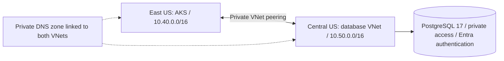
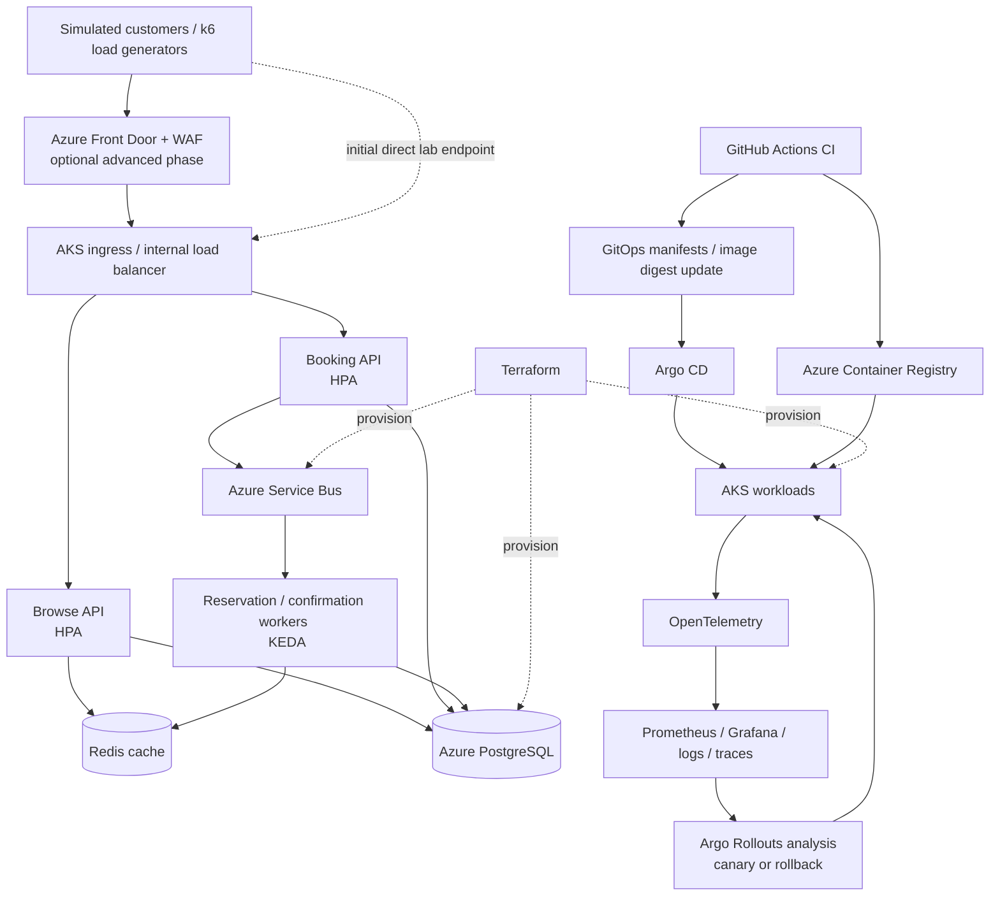

# Azure TrafficForge

trafficXX is a learning project for building a reliable ticket reservation backend
and operating it on Azure. We build in small steps, test failures, and record what
we learn in [memeory.md](memeory.md).

## Verified progress - updated 2026-10-23

| Part | Implemented and verified |
|---|---|
| Local backend | Dockerized FastAPI browse/booking APIs, PostgreSQL, five-minute holds, confirmation, cancellation, and expiry |
| Booking correctness | Atomic group reservations, database locking, and customer-scoped idempotency; 37 PostgreSQL integration tests passed locally |
| Messaging | Transactional outbox, stable message IDs, consumer inbox, retries, dead letters, and replay; five real-AMQP emulator tests passed locally |
| Backlog recovery | Stopped the consumer, observed age/heartbeat alerts, restarted it, and verified that outstanding work drained |
| Application CI | GitHub Actions builds/tests the application and produces vulnerability reports and an SBOM; [verified full run](https://github.com/milliyin/trafficXX/actions/runs/39126094347) included the broker tests |
| Azure foundation | Terraform state storage, networking, ACR, and a Log Analytics workspace created through user-run Cloud Shell commands |
| AKS | Standard cluster in East US; two system and two application nodes verified Ready, with system pod readiness checked |
| Private database | PostgreSQL 17 in Central US, private DNS and VNet peering to AKS; administrator SQL login verified with certificate-checked TLS 1.3 |
| Workload identity | Eight Azure identities, trust records, and Kubernetes service accounts installed; browse, migrator, booking, expiry, publisher and consumer pod SQL logins verified over TLS 1.3 with no administrator privileges |
| Cloud database schema | Base and messaging migrations applied by the migrator identity; ten tables verified with migrator ownership |
| Browse database permissions | Real browse pod passed three required reads and nine permission-denied checks, including writes, schema creation and private reservation data |
| Browse API on AKS | ACR image built; two replicas Ready on separate apps nodes with zero restarts at rollout; health/readiness/events HTTP checks passed |
| Cloud demo inventory | Migrator created two demo events with 100 units each; real API reported 100 available for both general and assigned-seat events |
| Browse pod recovery | One pod deleted normally; new owned pod and two Ready replicas observed in 12.5 seconds; post-recovery API still reported 100 available for each demo event |
| Booking database permissions | Registered workload login over TLS 1.3; eleven required SQL operations and twelve 42501 denials verified with all diagnostic rows rolled back |
| Booking API flow on AKS | Real HTTP hold, identical retry, changed-request rejection, other-customer lookup denial, repeated cancellation and cancelled-key replay passed; final reservation status CANCELLED |
| Inventory after cancellation | Subsequent Browse HTTP check reported both demo events at 100 available, with health alive and database readiness ready |
| Duplicate requests across Booking replicas | One concurrent client request per pod returned 201/200 with the same reservation and expiry; both pods read the hold and its final CANCELLED status |
| Assigned-seat contention across replicas | Different customers requested A1 concurrently: one 201 hold and one 409 SEAT_UNAVAILABLE; both replicas agreed on the winner and final CANCELLED status |
| Real hold expiry and seat reuse | After a real 305-second wait, a booking transaction expired the old A1 hold and created a replacement; both replicas verified EXPIRED, old-key replay stayed expired and replacement was cancelled |
| Background expiry worker | Own non-admin login and grants verified; nine allowed SQL operations and fourteen denials passed. Idle A2 hold became EXPIRED after a 310-second wait; read-only SQL found zero assignments and one EXPIRED outbox row with no expiry-triggering API calls after creation |
| Private Service Bus access | Publisher resolved and connected to private endpoint 10.40.17.4 over TLS 1.3, opened a sender link and was denied receive access; that diagnostic sent zero messages |
| First live outbox publication | Real application publisher sent outbox row 3 with stable message ID, received acknowledgement, confirmed its committed published marker and recorded a heartbeat |
| Continuous publisher drain | Read-only SQL reported 12 total/published outbox rows, zero pending rows/failed attempts, and an error-free publisher heartbeat about 0.67 seconds old |
| Consumer private queue access | Consumer verified private endpoint 10.40.17.4 over TLS 1.3; main/dead-letter peek allowed, send denied, zero messages consumed by the diagnostic |
| Consumer database permissions | Exact grants verified, then 14 required operations and 30 denials passed as the consumer over TLS 1.3; diagnostic writes rolled back and no broker messages sent or received |
| Live monitoring warning and recovery | Consumer pause produced aged-processing and stale-heartbeat signals in JSON/metrics; restart cleared both, emptied the native queue and verified18inbox events/nine latest projections. One additional publish failure was recorded and delivery recovered; cause undiagnosed |
| Internal operations monitoring | One read-only operations replica deployed; live health/readiness/backlog and worker/alert metric checks passed with no active alerts. Historical audits remain separate; notification delivery is not configured |
| Metrics and HTTPS dashboard | Prometheus verified stored samples. Grafana's Azure HTTPS endpoint passed certificate/redirect checks, Secure HttpOnly cookie login, twelve-panel/datasource query checks and diagnostic logout. User confirmed browser login and supplied screenshots of all twelve panels rendering with data |
| Invalid message isolation and recovery | Unsupported schema was dead-lettered with INVALID_EVENT_SCHEMA; business-table fingerprints stayed unchanged; targeted cleanup emptied the queue. Follow-up SQL verified 16 events/eight latest projections, a retained rejection audit and healthy heartbeat; native queue counts all zero |
| Azure consumer backlog recovery | With zero consumer pods, two hold/cancel events waited in the queue; restoring one replica drained it to zero. Read-only SQL verified all 14 inbox records and seven latest projections, with no mismatches/failure records and a healthy heartbeat |
| Duplicate message delivery | One acknowledged resend of the original message produced a new duplicate outcome; all inbox/outbox/projection counts and full-row fingerprints stayed unchanged, and native queue counts returned to zero |
| Consumer processing and drain | Read-only SQL verified all 12 inbox records and six latest projections with zero mismatches/orphans/failure records, plus an error-free heartbeat aged 2.81 seconds; Azure queue counts were active=0, dead_letters=0, total=0 |
| Queue before consumer | Azure reported 12 active messages, zero dead letters and 12 total messages, matching the published outbox count at this checkpoint |

**Browse and Booking are deployed to AKS as internal services.** Booking rollout
passed with two Ready replicas on separate application nodes; its HTTP check
verified health, database readiness, the correct API module and a missing reservation.
The expiry worker is deployed and passed a controlled idle-hold expiry experiment
with raw read-only SQL evidence. A one-shot publisher Job passed; its continuous
Deployment emitted successful publication logs and passed the read-only drain
check. The consumer processed all 12 queued events: read-only SQL verified
12 matching inbox records, six matching latest status projections and a fresh,
error-free heartbeat. Native queue counts were zero active messages and zero
dead letters. These are point-in-time processing and drain results. Remaining
workers are not deployed.
Remaining workload SQL permissions, broader recovery experiments and sustained
token-renewal verification are next steps. The base and messaging schema have
been bootstrapped. A controlled duplicate resend also passed with unchanged
stored state and an empty queue. A controlled consumer pause also passed:
two events waited, then drained after restart, with 14 inbox records and seven
latest projections verified. An invalid-schema diagnostic was isolated and
cleaned up without business-table changes; valid follow-up processing verified
16 events/eight projections, with a retained rejection audit and empty queue.
Further failure experiments,
ingress, GitOps, production customer authentication,
load benchmarks, and restore experiments remain ahead. Customer identity in the
local API is simulated. The logging workspace exists; cloud telemetry collection
has not been enabled.

The CI gate blocks fixable HIGH/CRITICAL findings. Previously recorded unfixed
HIGH advisories remain unresolved; a passing gate does not mean the image is
vulnerability-free. See [CI evidence and policy](docs/ci.md). Terraform formatting
and validation have been run locally; the current application CI does not validate
or deploy Terraform.

### Current Azure layout



PostgreSQL provisioning was restricted for this subscription in East US and East
US 2. Central US advertised support, so we kept AKS intact and added a separate
database network. This introduces cross-region latency and data-transfer charges;
it is not database high availability or disaster recovery. The original East US
PostgreSQL subnet remains reserved and unused.

## Run the local backend

The optional [messaging profile](docs/messaging.md) adds Microsoft's Service Bus
emulator and its separate SQL Server dependency. Its license acceptance must be
configured for each environment. The commands below start the basic backend and
run its database tests.

```powershell
docker compose up --build -d db browse booking expiry-worker
docker compose --profile test run --build --rm tests
```

Open the Browse API at http://localhost:8001/docs and Booking API at
http://localhost:8002/docs. See [local setup and examples](docs/local-development.md),
the [implemented design and API contract](docs/architecture.md), and the
[running work log](memeory.md).

### Local settings and credentials

- Put private local settings in `.env`, which Git and Docker build context ignore.
  `.env.example` contains disposable examples, not production credentials.
- `SERVICEBUS_SQL_PASSWORD` in `.env` matches the current local emulator setup.
  This setting is separate from Azure PostgreSQL, which uses Entra authentication.
- Azure access tokens are obtained at runtime. Keep them out of `.env`, source
  files, screenshots, and logs; the deployed APIs use workload identity.
- Real Terraform variable/backend files, state, plans, downloaded providers, and
  generated test evidence are excluded from Git. Protect the bootstrap state in
  Cloud Shell as well as the foundation's remote state in Azure.

## Resume checkpoint

Work resumed on 2026-10-22 in a new Cloud Shell session. The repository and
existing remote foundation state were recovered; all four AKS nodes were Ready.
The browse, migrator and booking identities are registered and their real pod SQL logins
passed. Both schema migrations ran and ten tables have migrator ownership.
Browse read grants have been applied and its real pod passed three allowed reads
and nine forbidden operations with SQLSTATE 42501 over TLS 1.3, without admin
privileges. The ACR runtime image was built and the real Browse API rolled out
with two Ready replicas on separate apps nodes, zero restarts at that observation,
and BROWSE_HTTP_OK. The controlled seed then created two events with 100 units
each; BROWSE_DEMO_HTTP_OK reported two events and 100 available for both.
The single-pod recovery drill passed in an observed 12.5 seconds, followed by
healthy demo HTTP responses with inventory intact. Booking's database grants and
real API experiments also passed, as recorded below. Worker identities' SQL
registration and permissions remain pending.
Next:

1. Booking's sequential [hold/retry/cancel experiment](docs/booking-api-azure.md#test-a-real-hold-retry-and-cancellation)
   passed; subsequent Browse HTTP reported 100 available for both demo events.
   Concurrent duplicate requests and different customers competing for assigned
   seat A1 also passed across both replicas; post-test Browse availability was
   100 for each demo event. Real five-minute expiry and seat reuse also passed
   via a booking transaction; final Browse HTTP again showed 100 available for
   each event. The expiry worker's [own SQL login](docs/expiry-worker-azure.md) passed over
   TLS 1.3 without administrator privileges. Its table-grant Job also passed;
   its real probe passed nine allowed operations and fourteen denials without
   committed diagnostic changes. Its deployment produced authentication logs.
   Its [idle-hold observer experiment](docs/expiry-worker-azure.md#verify-idle-expiry-using-raw-stored-state)
   then verified worker readiness, stored expiry, assignment release and one
   EXPIRED outbox row. Final Browse availability again showed 100 for both
   demo events. The [publisher SQL login](docs/publisher-azure.md) now passed;
   its outbox/heartbeat grant Job and actual SQL permission probe also passed
   (nine allowed operations, 23 denials, no committed diagnostic changes or sent
   messages). The private Service Bus plan had six additions and no existing
   changes; the user supplied the resulting namespace/queue/private-endpoint
   outputs. Its AKS check passed private DNS/TLS and sender-link access, with
   receive access denied and no messages sent. The one-event publisher Job then
   passed a real send, persisted publication readback and heartbeat. The continuous
   publisher passed the read-only drain check: 12 published, zero pending and
   a fresh error-free heartbeat. Azure reported 12 active messages and zero dead
   letters. The [consumer workload SQL login](docs/consumer-azure.md) passed with
   TLS 1.3 and no administrator privileges. Its table-grant Job and real SQL
   operation checks passed (14 allowed, 30 denials). Its receiver role plan matched
   the consumer and exact queue scope; foundation outputs were supplied after
   the apply instruction. Its private broker check passed main/dead-letter peek
   access and send denial over TLS 1.3 without consuming messages. The
   consumer emitted 12 processed logs, then passed read-only verification of
   12 matching inbox records, six latest projections and a fresh heartbeat. Native
   queue counts were all zero. The [duplicate-delivery baseline](docs/consumer-duplicate.md) also passed
   (12 inbox rows, six projections, 12 outbox rows with full-state fingerprints).
   One resend then produced a new consumer duplicate outcome; all three table
   fingerprints/counts stayed unchanged and native queue counts returned to zero.
   The [consumer outage/backlog experiment](docs/consumer-backlog.md) then passed:
   two events waited with zero consumer pods and drained after restoration. SQL
   verified 14 inbox rows and seven latest projections. The [invalid-message experiment](docs/consumer-poison.md) then verified
   INVALID_EVENT_SCHEMA dead-lettering, unchanged business-table fingerprints
   and targeted cleanup back to an empty queue. The follow-up read-only observer
   verified 16 events/eight latest projections and the retained rejection audit;
   native queue counts were all zero. The
   [operations SQL identity setup](docs/operations-azure.md) passed its real
   non-admin TLS login and exact column-scoped monitoring grants. The
   real monitoring-query/permission checks passed (four query paths, 30 denials).
   Updated monitoring source now separates historical audits, detects missing
   expected workers and exports worker/alert gauges. ACR build ca2 passed for the updated image. The internal
   operations deployment and healthy HTTP/worker-metric checks passed. The live
   drill then verified aged-backlog/stale-consumer warning gauges appeared and
   cleared after recovery, with18matching inbox records/nine projections and
   an empty native queue. The [private Prometheus collector](docs/prometheus-azure.md) passed stored-sample
   verification. The [Grafana dashboard](docs/grafana-azure.md) API check passed:
   twelve provisioned panels, a healthy datasource, a real Prometheus query and
   rejection of unauthenticated dashboard access. Next verify browser login and
   panel rendering. A dummy-cookie probe found server-set cookie handling fails
   through the current Cloud Shell preview, while browser-written cookies work.
   The user chose a [stable Azure HTTPS address](docs/grafana-https-azure.md).
   The user-run reservation returned a static IP and Azure hostname. Credential
   rotation/session revocation and Secret synchronization passed. The dedicated
   HTTPS gateway deployed and passed trusted-certificate, redirect, cookie-login,
   twelve-panel/datasource query and diagnostic-logout checks. Browser login and
   all twelve panels rendering with data are confirmed by user screenshots.
   A further45second warning observation exercise raised both stale-consumer and
   aged-backlog flags, but its overall runner reported a recovery-stage error.
   Independent follow-up checks confirmed a Ready consumer, empty native queue,
   clear current warnings and20matching inbox events/ten projections. The runner
   failure and publication-failure counter increase from2to3 remain undiagnosed.
   [Publisher logs](docs/publisher-retries.md) show three retries followed by
   successful publication after idle periods; idle-link closure is a hypothesis.
   Class-only diagnostic logging passed ACR build ca3 and its pinned publisher
   rollout. A normal booking/cancel flow then reached22processed events with
   zero backlog/warnings and no new publication failure. A later13minute quiet
   interval reproduced ServiceBusConnectionError followed by successful retries,
   reaching28processed events and failure history4. An eight-minute idle sender
   refresh passed ACR build ca4, rollout and a user-run quiet-period test:
   refresh logged at481idle seconds, both new events published,30processed,
   failure history unchanged at4 and no backlog or current warnings. This supports
   the mitigation for this case; the exact earlier AMQP condition remains unknown.
   External notification delivery remains unconfigured.
2. Build and verify the [Browse database pool](docs/database-pooling.md): one
   bounded pool per process, fresh token parameters for new connections and
   shared readiness/request borrowing. Azure build ca6, two-pod rollout, demo
   HTTP and isolated SQL reuse/rollback/capacity/replacement checks passed.
   A [bounded serving-pod concurrency check](docs/browse-concurrency.md) passed
   after ca7 build/rollout:60test reads,32pool borrows and only two new connection
   attempts per pod; highest sampled pool size three/configured maximum four.
   This supports reuse for that workload, not a sustained-load SLO. A subsequent
   [Booking pool stage](docs/booking-database-pooling.md) is prepared in source;
   ACR build ca9, two-pod rollout, read-only serving reuse (four borrows/no new
   attempts), and isolated SQL reuse/rollback/capacity/replacement checks passed.
   The sequential pooled booking flow also passed duplicate/key-conflict,
   customer isolation and cancellation checks. Concurrent requests through both
   new replicas returned one reservation/expiry (HTTP200/201), then cancellation
   passed. A same-seat race through both replicas also passed: one201, one409
   SEAT_UNAVAILABLE, winning reservation cancelled. Post-test demo inventory was
   restored to100each; Operations reported36processed, no backlog/active warnings,
   and fresh error-free workers. These are bounded functional checks.
   [Booking pool monitoring](docs/booking-pool-monitoring.md)
   is prepared in source with separate per-pod series and an eight-panel dashboard;
   image build caa, rollout, HTTP reuse, two healthy targets with fresh stored
   samples and eight-panel Grafana API checks passed. Operations and Browse
   dashboard/rule verification also passed. User screenshots confirm all eight
   Booking panels render with data (47process borrows/two connection attempts
   at that checkpoint, including readiness). Workers still
   connect directly. [Browse pool Prometheus/Grafana monitoring](docs/browse-pool-monitoring.md)
   passed after ca8 build/deployment: two healthy discovered targets with fresh
   stored samples and an eight-panel dashboard verified through its datasource.
   User screenshots confirm all eight panels render with live data; a further
   bounded read test passed on ca8. Sustained-load and token-renewal tests remain.
   A [background token-renewal check](docs/database-token-renewal.md) is prepared
   using the existing image and real SDK expiry metadata. At17hours, the same
   run had209successful SQL checks and zero pod restarts; observed token expiry
   had advanced. This supports ongoing refresh but is not the final verdict;
   earliest final check is2026-10-24T16:01:40Z. Expiry-boundary proof remains
   pending; short requests do not establish renewal.
   [Browse pool alert rules](docs/browse-pool-alerts.md) are prepared and tested
   separately while that Job runs. AKS loading/evaluation passed: all five rules
   healthy and inactive, two Browse targets with fresh stored samples. External
   notification delivery remains unconfigured.
   A dashboard-only follow-up adds pending/firing alert counts and history
   (ten Browse panels total). Live API verification passed: both targets,
   five healthy inactive rules and zero pending/firing alert counts. Browser
   rendering of the two additions remains unconfirmed.
   See the [deployment steps](docs/browse-pool-alerts.md#show-pending-and-firing-alerts-in-grafana).
   A [bounded read-only load baseline](docs/read-load-baseline.md) passed
   with 600 valid read responses, no workload errors,
   and unchanged pods/inventory. At 8 requests/s per API, Browse p95 was 203.162 ms
   and Booking missing-lookup p95 was 165.072 ms; sampled waiting peaked at 1 on
   two pods, with pool sizes below 4 and unchanged error counters. This is a
   short internal read baseline, not a latency SLO or booking-write benchmark.
   [Booking pool alert rules](docs/booking-pool-alerts.md) passed local tests and
   live loading/evaluation: five healthy inactive rules, two targets and fresh
   stored samples. All five existing Browse rules also remained healthy and
   inactive. External notification delivery remains unconfigured.
   A [Booking dashboard follow-up](docs/booking-pool-alerts.md#show-pending-and-firing-alerts-in-grafana)
   adds pending/firing counts and history (ten panels total). Live API checks
   passed with two targets, five healthy inactive rules and zero active counts;
   the user confirmed the additions are visible in the browser.
   A [controlled Booking target-warning drill](docs/booking-alert-recovery.md)
   observed the target warning firing with one healthy scrape target, then
   restored two ready replicas and five inactive rules. The complete recovery
   result verified stored firing history and the original surviving pod, with
   no inventory writes. HTTP continuity and external notifications were not tested.
3. Configure and test the remaining worker identities' SQL permissions before
   deployment. Keep future schema changes in additive migrations. Single-pod
   replacement does not establish zero downtime or node/zone failure recovery.

Azure commands are run personally in browser Cloud Shell from
`~/trafficxx/infrastructure/foundation` in the restored clone. Azure resources remain running; local Docker services
were stopped at the last checkpoint. Diagnostic Jobs have automatic cleanup;
long-term stability, restore behavior, and application performance are unverified.

On 2026-10-23, a fresh Cloud Shell connection confirmed all four nodes Ready
and all four API pods still Running/Ready with zero restarts. This pod snapshot
does not establish continuous HTTP availability or token refresh across expiry.

Guides: [AKS](docs/aks.md), [private PostgreSQL](docs/postgresql.md),
[workload identity](docs/workload-identity.md), [schema bootstrap](docs/schema-bootstrap.md), [local architecture](docs/architecture.md),
[Browse API on Azure](docs/browse-api-azure.md), [messaging](docs/messaging.md), and [CI](docs/ci.md).

The latest runtime experiments and commands are in the
[Booking API guide](docs/booking-api-azure.md). Cloud Shell upload bundles are
local convenience files and are excluded from Git. This checkpoint is published;
use the repository files directly instead of uploading ZIPs:

```bash
cd ~/trafficxx
git pull --ff-only origin main
python3 -m unittest discover -s unit_tests -q
```

Run experiment scripts from this repository root. Local validation currently
passes 403 offline tests; SDK/database responses and the expiry clock are mocked
there. The Azure results above come from separate user-run real experiments.
Future pushes trigger hosted CI; their result must be checked separately.

## Target platform and roadmap

The sections below describe the broader target, including features not yet built.

**Target: high-traffic, self-healing platform on Microsoft Azure**

> **Level:** Advanced / Expert DevOps | **Cloud:** Microsoft Azure | **Focus:** Traffic engineering, Kubernetes, platform engineering, reliability, security and disaster recovery

## Overview

Azure TrafficForge is a portfolio-grade DevOps project that simulates the infrastructure behind a high-demand concert ticketing service. During a flash sale, thousands of users browse events, reserve tickets and submit bookings at once. The main engineering challenge is not the frontend: it is keeping the platform responsive, consistent, secure, observable and recoverable under load.

**Primary goal:** Build a reproducible Azure platform that can autoscale under traffic, tolerate component failures, safely roll back faulty releases, and recover from incidents - all demonstrated with repeatable experiments and measured evidence.

### Project targets (aspirational, not guaranteed)

| Metric | Target | Scope / qualification |
|---|---:|---|
| Peak throughput | **10,000 requests/second** | Stretch load-test goal; subject to Azure quota, budget and application design |
| p95 response latency | **< 300 ms** | Lightweight browse endpoint under an explicitly documented test load |
| Availability | **99.9%** | Target SLO; estimate from measured service indicators over a stated evaluation window |
| Application rollback | **< 2 minutes** | Measured from failed-release detection to recovered service |
| Inventory consistency | **Zero oversold tickets** | Verified under concurrent booking tests |

These numbers are **goals to investigate**, not promises or prevalidated benchmarks. Always publish the workload, concurrency, VM/node sizes, region, costs and actual results alongside any performance claim.

---

## 1. Problem statement and scenario

A concert organizer announces a major ticket sale. Normal traffic suddenly grows into a flash crowd. At the same time, some booking operations must be serialized or guarded with database transactions to avoid overselling inventory.

The platform must:

- Serve browse traffic quickly and scale API replicas as demand rises.
- Accept reservations without selling the same ticket twice.
- Process slow or asynchronous booking tasks through queues and workers.
- Absorb and recover from traffic spikes or worker backlogs.
- Detect errors, slowdowns and capacity issues with dashboards and alerts.
- Deploy updates safely with progressive rollouts and automated rollback.
- Resist basic security threats and prevent unauthorized secret access.
- Survive simulated pod/node outages and support verified data restore.
- Be provisioned and reproduced as code, with minimal manual portal steps.

**Non-goals at first:** building a full payment gateway, multi-environment infrastructure, or a production-ready public ticket marketplace. Payments should be simulated; no actual card data is required. Begin with **one lab environment**, then introduce advanced resilience features after the core platform works. The current lab spans two regions because of PostgreSQL provisioning restrictions, as documented above.

## 2. Target architecture



**Architecture notes:** The diagram is conceptual. Terraform provisions Azure resources; Helm/manifests manage Kubernetes applications. Start with a simple ingress; add Front Door Premium, WAF, Private Link and private ingress only after confirming regional support and costs. Redis is a cache rather than the source of truth for ticket inventory. PostgreSQL enforces the reservation consistency rules.

### Core components

| Layer | Technology | Purpose |
|---|---|---|
| Infrastructure | Terraform | Azure networking, AKS, ACR, identities, database, messaging, remote state |
| Compute | AKS Standard, Docker | Kubernetes services, node pools, resource controls |
| Applications | FastAPI (example), lightweight frontend | Browse, reserve and process ticket orders |
| Ingress | Kubernetes ingress; optionally Azure Front Door + WAF | HTTPS entry point, routing, protection |
| CI/CD | GitHub Actions | Tests, scans, builds, signing, deployment updates |
| GitOps | Argo CD | Desired-state reconciliation from Git |
| Progressive delivery | Argo Rollouts | Canary releases, metric-driven rollback |
| Autoscaling | HPA, KEDA, AKS cluster autoscaler | Replica and node scaling against load |
| Messaging | Azure Service Bus | Asynchronous processing and dead-lettering |
| Data | Azure Database for PostgreSQL | Durable inventory, reservations and orders |
| Cache | Redis | Cache and optional rate-limiting data |
| Observability | OpenTelemetry, Prometheus, Grafana, logs, tracing | Metrics, traces, investigation, alerting |
| Security | Microsoft Entra Workload ID, Key Vault, Trivy, Kyverno | Identity, secrets, image scanning and policies |
| Testing | k6 | Baseline, stress, spike and soak tests |
| Resilience | LitmusChaos and/or Azure Chaos Studio | Controlled fault injection and recovery testing |

## 3. Application design and business rules

Implement a small application with three main backend components:

1. **Browse API:** list available concerts and ticket availability; supports caching and high read throughput.
2. **Booking API:** create reservations, enforce idempotency and inventory constraints, publish booking events.
3. **Worker:** consume Service Bus events, process simulated confirmations, retry transient failures and dead-letter poison messages.

Suggested endpoints:

| Endpoint | Purpose |
|---|---|
| `GET /healthz` | Liveness status |
| `GET /readyz` | Dependency-aware readiness |
| `GET /events` | Browse events |
| `GET /events/{id}/availability` | Read ticket availability |
| `POST /reservations` | Atomic reservation with idempotency key |
| `GET /reservations/{id}` | Reservation status |
| `POST /reservations/{id}/confirm` | Simulated confirmation |

Use database transactions and properly constrained updates to prevent overselling. Design reservation expiration and cancellation carefully. Do not treat Redis cache counters as authoritative inventory. Use idempotent consumers, bounded retries, dead-letter queues and an outbox-style event publication mechanism if reliable database-to-queue consistency is required.

**Correctness experiment:** Seed 100 tickets, generate 1,000 concurrent booking attempts, and assert that confirmed plus active reserved inventory never exceeds 100. Record failures, retry behavior, duplicate requests and processing lag.

## 4. Functional and non-functional requirements

### Functional

Checked items below refer to the local implementation and its test coverage;
they do not imply the application is deployed on Azure.

- [x] Browse catalog and inventory through HTTP APIs.
- [x] Reserve and confirm tickets with concurrency checks against overselling.
- [x] Publish booking events and process them asynchronously using the local emulator.
- [x] Handle duplicate submissions through idempotency keys.
- [x] Expire unconfirmed reservations.
- [x] Provide health/readiness endpoints and backlog metrics.
- [ ] Add application-wide structured logging and distributed tracing.

### Reliability, operations and security

- [ ] Rebuild infrastructure from Terraform with no untracked manual steps.
- [ ] Deploy from Git through a reviewed, auditable CI/CD process.
- [ ] Enforce resource requests/limits, probes, disruption budgets and spread constraints.
- [ ] Scale stateless services and queue consumers automatically.
- [ ] Define measurable SLIs/SLOs and alert on meaningful degradation.
- [ ] Demonstrate a canary rollout and automatic rollback.
- [ ] Verify least-privilege service identities and pod-to-pod network restrictions.
- [ ] Run controlled chaos tests without affecting external systems.
- [ ] Test backups and restore with documented RTO and RPO.
- [ ] Track infrastructure and test costs, and clean up unused resources.

## 5. Implementation phases

### Phase 1 - Reproducible Azure foundation

**Build:** Terraform remote state, resource groups, Azure VNet/subnets, AKS Standard, separate system/user node pools, ACR, managed identities and role assignments, PostgreSQL, Service Bus, basic ingress and monitoring primitives.

**Learn:** Terraform modules, state locking/management, Kubernetes networking, node scheduling, Azure identity, networking boundaries and resource quotas.

**Experiment:** Tear down a disposable stack and recreate it using CI. Record deployment time and any manual intervention. **Be careful:** databases and other stateful resources require explicit backup/retention handling before destruction.

**Exit criteria:** Documented `terraform plan`/`apply`, a working cluster, private-access decisions, successfully pulled container images and a clean reproducibility report.

### Phase 2 - Traffic-ready application

**Build:** Containerized browse API, booking API, worker, PostgreSQL schemas, Redis caching and Service Bus queues. Add readiness probes and structured logs.

**Experiment:** Concurrently request 1,000 reservations for 100 tickets. Also test duplicate keys, worker retries and queue dead-letter behavior.

**Exit criteria:** No overselling; duplicates handled safely; observable request and queue outcomes.

### Phase 3 - Secure CI/CD and GitOps

**Build:** GitHub Actions tests; Trivy image and dependency scans; SBOM generation; immutable versioning by digest; optional image signing; Argo CD sync; Argo Rollouts canary steps of **5% -> 25% -> 50% -> 100%**.

**Experiment:** Deploy a deliberately slower or error-prone version and use verified rollout analysis to abort/roll back. Ensure Git's desired state and the rollback strategy cannot continuously reintroduce the broken artifact.

**Exit criteria:** Traceable commit-to-cluster release, signed/scanned artifact evidence where implemented, and measured rollback duration.

### Phase 4 - Observability and SLOs

**Build:** OpenTelemetry traces, Prometheus metrics, Grafana dashboards, centrally searchable logs and actionable alert rules.

Instrument the **RED signals** (request rate, errors, duration), plus node CPU/memory, pod restarts, queue depth, worker lag, database saturation and dependency errors.

**Experiment:** Introduce a slow database query or limited connection pool; diagnose the latency regression through telemetry.

**Exit criteria:** Dashboard screenshots, trace examples, alert examples and a written root-cause walkthrough.

### Phase 5 - Autoscaling and traffic engineering

**Build:** HPA for APIs, KEDA for Service Bus workers, AKS node autoscaling, PodDisruptionBudgets, topology spread constraints and realistic requests/limits.

**Experiment:** Run baseline, ramp, flash-spike and recovery tests. Capture throughput, p50/p95/p99 latency, failures, pod counts, node counts and queue depth.

**Exit criteria:** Demonstrate automatic scale-out and scale-in and distinguish application scaling bottlenecks from database and quota limits.

### Phase 6 - Zero-trust-oriented hardening

**Build:** Microsoft Entra Workload ID, Key Vault access, GitHub OIDC to Azure, least-privilege Kubernetes and Azure RBAC, network policies, Kyverno policies and security scans.

**Experiment:** Attempt to access secrets or prohibited internal endpoints from an intentionally unprivileged test pod.

**Exit criteria:** Failed unauthorized access attempts, passing policy tests and documented trust boundaries. Never print real secrets in public logs or screenshots.

### Phase 7 - Chaos engineering and incident response

**Build:** Controlled experiments with pod termination, node drain, dependency network interruption, response delays and worker failures. Choose LitmusChaos or supported Azure Chaos Studio faults according to current availability.

**Experiment:** Inject failures while controlled load is running; measure time to detection, time to recovery, customer-visible errors and data consistency.

**Exit criteria:** An incident timeline, dashboards and a blameless postmortem for every major scenario. Stop conditions and cleanup must be defined before tests.

### Phase 8 - Disaster recovery and rebuild

**Build:** Backup policy, restore playbooks, immutable image retention, infrastructure rebuild instructions, database recovery verification and optional secondary-region expansion.

**Experiment:** Restore application service and a known data snapshot into a disposable recovery setup. Validate recovered reservations, data integrity and application health.

**Exit criteria:** Measured **RTO** (recovery time objective) and **RPO** (recovery point objective), evidence of restore, and a complete runbook.

## 6. Traffic and performance test plan

Use k6 locally first. For higher loads, use dedicated/distributed generators or a managed load-testing service and measure generator saturation independently from server saturation.

| Test | Illustrative load | What it reveals |
|---|---:|---|
| Smoke | 10-50 RPS | Functional correctness and baseline instrumentation |
| Baseline | 100 RPS | Normal latency, resource use, error rates |
| Ramp | 100 -> 1,000 RPS | Initial scaling behavior and bottlenecks |
| Flash sale | 1,000 -> 5,000 RPS | Burst capacity and cold-start lag |
| Extreme stretch | Up to 10,000 RPS | Capacity ceiling **only if quota and budget allow** |
| Soak | Moderate sustained load | Leaks, gradual saturation and stability |
| Failure during load | Controlled load + injected fault | Recovery, failover and error budget impact |

### Capacity calculation (illustrative only)

If a pod can sustainably serve `150 RPS` (measured in a real test) and you want 30% spare capacity:

```text
usable throughput per pod = 150 * (1 - 0.30) = 105 RPS
estimated replicas at 1,000 RPS = ceil(1000 / 105) = 10 pods
estimated replicas at 10,000 RPS = ceil(10000 / 105) = 96 pods
```

This simple sizing formula assumes roughly linear scalability, healthy downstream services and sufficient cluster capacity. It **does not** size Kubernetes nodes, PostgreSQL, message processing, ingress, networking or load generators. Replace the assumed per-pod throughput with observed results. Configure HPA/KEDA maximums and Azure quotas deliberately.

### Required benchmark report

For every test, record:

- Date/time, Azure region, active Azure SKUs and AKS node sizes/counts.
- Tool, scenario, virtual users, RPS, duration, request mix and dataset.
- p50/p95/p99 latency, throughput, HTTP error percentages and timeouts.
- Pod replicas, scaling event times, node utilization and database metrics.
- Service Bus backlog, processing rate, retries and dead-letter count.
- Costs for running the environment and the test, with assumptions.
- Unexpected failure modes, bottlenecks and engineering changes made.

## 7. Example demonstrations

1. **Traffic spike:** Raise request rate; show KEDA/HPA and cluster scale-out followed by a stable plateau and scale-in.
2. **No oversell:** Fire concurrent booking requests; show database invariants and a consistency test report.
3. **Bad release:** Deploy a version that increases 5xx errors or latency; show canary analysis rejecting it and application health recovering.
4. **Dependency slowdown:** Introduce latency; correlate a trace with DB metrics and app error budget impact.
5. **Least privilege:** Attempt unauthorized API/Key Vault access with a test identity and show policy-denied access.
6. **Node disruption:** Drain a node during test traffic and show rescheduling, disruption-budget effects and actual error rates.
7. **Recovery:** Restore a known database snapshot in a test environment, verify sample orders and report RTO/RPO.

Do not run disruptive tests on shared or customer infrastructure. Load test only endpoints you own or are authorized to test.

## 8. Current repository layout

```text
trafficXX/
|-- trafficxx/                  # APIs, reservation logic, messaging, workers
|-- database/                   # Base schema, demo seed, additive migrations
|-- infrastructure/
|   |-- bootstrap/              # Terraform state storage
|   `-- foundation/             # AKS, networking, PostgreSQL, workload identities
|-- kubernetes/checks/          # Workload-identity diagnostic Job
|-- scripts/                    # Backlog drill and administrator SQL/TLS check
|-- messaging/                  # Local Service Bus emulator configuration
|-- tests/                      # PostgreSQL and real-AMQP integration tests
|-- ci/                         # Container CI wrappers and security summaries
|-- .github/workflows/ci.yml     # Application CI
|-- docs/                       # Architecture, setup, and learning guides
|-- compose.yml                 # Local Docker environment
|-- Dockerfile                  # Application runtime and test targets
|-- .env.example                # Disposable local configuration examples
|-- memeory.md                  # Decisions, errors, fixes, evidence, resume notes
`-- README.md
```

GitOps manifests, application deployments, infrastructure CI, dashboards, load
tests, chaos experiments, and disaster-recovery runbooks are future additions.

## 9. Ten-week roadmap

| Week | Main deliverable | Proof of completion |
|---:|---|---|
| 1 | Terraform networking, state, identities and budget controls | Infrastructure plan and networking diagram |
| 2 | AKS node pools, ACR, ingress, basic deployments | Working container on AKS |
| 3 | Browse/booking APIs, PostgreSQL, Service Bus, worker | Concurrent reservation consistency test |
| 4 | GitHub Actions and Argo CD | End-to-end GitOps deployment |
| 5 | Argo Rollouts, canary metrics, rollback | Bad-release demo + rollback time |
| 6 | Telemetry and SLO dashboards | Trace and root-cause diagnosis |
| 7 | HPA/KEDA/node scaling + k6 scenarios | Load curves and scaling charts |
| 8 | Identity, secrets, network policies, scans | Security tests and least-privilege proof |
| 9 | Chaos experiments, incident drills | Incident reports and recovery timing |
| 10 | Backup restore, benchmark, cost evaluation | Final technical report and demo video |

Timelines are planning estimates, not guaranteed completion dates. Complete prerequisite phases before costly scale and resilience experiments.

## 10. Azure sponsorship, cost and safety

A sponsorship subscription can make a project like this feasible, but **confirm your own remaining credits, available regions, VM quotas and offer-specific spending restrictions** before deployment.

### Cost-conscious sequencing

- Start with a small single-region AKS lab; keep node-pool autoscaling maximums bounded.
- Use local/nonproduction Redis first; switch to a managed service when testing real availability requirements.
- Begin with local k6 rather than expensive distributed load generation.
- Reduce log volume and metrics retention; avoid high-cardinality labels.
- Add Front Door Premium, Private Link, advanced managed data SKUs and second-region resources only when the phase requires them.
- Schedule shutdown or destroy disposable resources between experiments; retain backups deliberately.
- Set Azure Cost Management budgets and notifications. **Budget alerts do not automatically impose a hard cost cap.**
- Document cleanup commands and keep a resource inventory to avoid leaving chargeable services running.

**Safety:** Use synthetic users and tickets. Never test against a third-party service without authorization; never include payment card data, real credentials or customer information.

## 11. Portfolio evidence and definition of done

The project is complete when there is objective, reproducible proof for each major capability:

- [ ] Reproducible Terraform deployment documented with state and networking design.
- [ ] Working API, queue workers and durable database with verified inventory consistency.
- [ ] GitHub Actions CI with test results, security scans, and traceable image artifacts.
- [ ] Argo CD reconciles cluster state from Git.
- [ ] Canary release rejects a measured bad deployment and restores service.
- [ ] Dashboards show request rate, errors, latency, scaling and queue processing.
- [ ] Autoscaling experiments include real load and before/after evidence.
- [ ] Least-privilege permissions and network policies have negative access tests.
- [ ] Chaos test findings include incident timelines and corrective actions.
- [ ] Backup restoration is successful with measured RTO and RPO.
- [ ] A final benchmark explains bottlenecks, scaling limits and cost/performance.
- [ ] Demo video shows load spike, scaling, bad release, rollback and recovery.

Suggested final artifacts: an architecture diagram, `docs/capacity-planning.md`, sample Grafana exports, k6 JSON/HTML outputs, release/runbook documentation, postmortems, security test results, a bill-of-materials/cost summary and a concise engineering case study.

### What makes this project stand out

Avoid claiming that merely deploying an application demonstrates expertise. The strongest evidence is a repeatable engineering story: **what failed, how it was measured, what was changed, what tradeoffs were made and how reliability or performance improved**.

## 12. References

Primary documentation to consult while implementing (product capabilities, pricing and availability can change):

- [AKS with Terraform verified module](https://learn.microsoft.com/en-us/azure/aks/deploy-cluster-terraform-verified-module)
- [AKS scaling concepts](https://learn.microsoft.com/en-us/azure/aks/concepts-scale)
- [Microsoft Entra Workload ID on AKS](https://learn.microsoft.com/en-us/azure/aks/workload-identity-overview)
- [Azure Chaos Studio documentation](https://learn.microsoft.com/en-us/azure/chaos-studio/)
- [Azure Cost Management](https://learn.microsoft.com/en-us/azure/cost-management-billing/)
- [Argo CD documentation](https://argo-cd.readthedocs.io/)
- [Argo Rollouts documentation](https://argo-rollouts.readthedocs.io/)
- [KEDA documentation](https://keda.sh/docs/)
- [Grafana k6 documentation](https://grafana.com/docs/k6/latest/)
- [OpenTelemetry documentation](https://opentelemetry.io/docs/)

---

**Project status:** Docker-based local backend and optional Service Bus messaging implemented; see the local setup and work log for verification results. Azure infrastructure, scaling, and broader resilience experiments remain planned.
