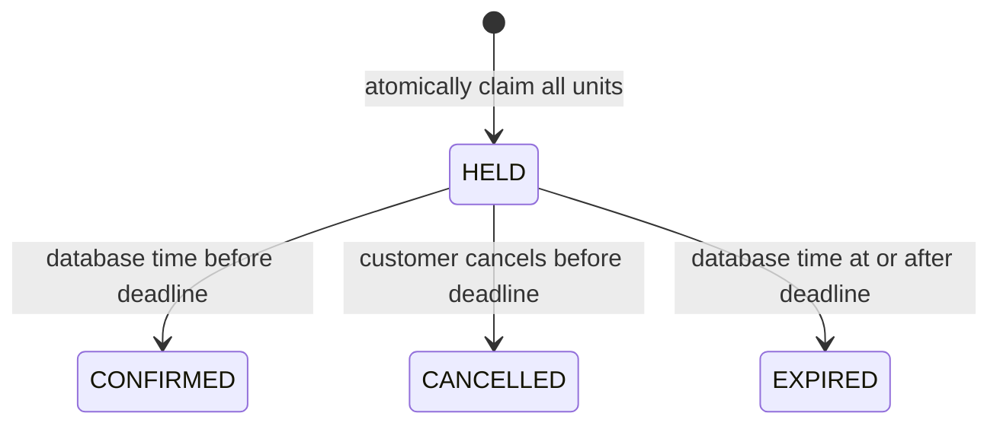

# Initial reservation design

## Services and ownership

Browse reads the catalog and inventory. Booking owns all inventory and reservation mutations. A periodic worker expires overdue holds every five seconds. All three currently share PostgreSQL and a small Python package; separate processes let us practice deployment boundaries while deferring independent codebases and databases.

An event uses either general-admission units or assigned seats. Both event types are supported in the same system; a single event mixing seating sections with general admission is not implemented. Every unit is a row. General-admission rows have no public seat label, while assigned units have unique labels within an event.

## Correctness and locking

All inventory writers first lock the event row using `SELECT ... FOR UPDATE`. The lock serializes changes within one event and is held to the transaction boundary. This deliberately simple design favors correctness over hot-event throughput. Different events can change concurrently. We will measure contention before replacing this with quantity counters or finer seat locks. PostgreSQL describes the locking semantics in its [row locking documentation](https://www.postgresql.org/docs/current/explicit-locking.html#LOCKING-ROWS).

A booking transaction first serializes its customer/idempotency key with a transaction advisory lock, then acquires the event lock. It expires overdue holds, validates all requested units, inserts the reservation, assigns every unit, and inserts an outbox event. A failure rolls the entire transaction back. Database uniqueness on `(customer_id, idempotency_key)` additionally protects duplicate creation.

Requests with the same customer/key and normalized body return the same reservation ID and original deadline, with its current status (`200`). New reservations return `201`. Different payloads with an existing key return `409`. Failed creates do not persist a key/outcome in this initial implementation, so retrying an unsuccessful request can succeed later if inventory changes. Successful keys are retained indefinitely for now. The header is scoped to reservation creation, not confirmation or cancellation.

## Reservation lifecycle

The hold lasts five minutes and cannot be extended by retries. Confirmation, cancellation, and expiry all acquire the same event lock and change the reservation and its units in one transaction. The transition checks database wall time after lock acquisition. Repeated confirmation of an already confirmed booking and repeated cancellation of an already cancelled hold succeed without repeating their effects. Other transitions from terminal states return `409`.

Expiry releases units once and emits one outbox event. Booking requests reclaim overdue holds without waiting for the worker. Reading a reservation also settles overdue holds for its event. Browse treats overdue holds as logically available; booking still revalidates under its lock. Availability remains advisory under concurrent requests.

## API contract

| Service | Endpoint | Behavior |
|---|---|---|
| Both | `GET /healthz` | Process liveness |
| Both | `GET /readyz` | Database connection/schema readiness |
| Browse | `GET /events` | List events |
| Browse | `GET /events/{id}/availability` | Available count and seats when applicable |
| Booking | `POST /reservations` | Require `X-Customer-Id`, `Idempotency-Key`, event ID, and either quantity or seats |
| Booking | `GET /reservations/{id}` | Require customer header; only that customer's reservation |
| Booking | `POST /reservations/{id}/confirm` | Simulated confirmation before expiry |
| Booking | `POST /reservations/{id}/cancel` | Cancel an active hold |

Errors use FastAPI's `detail` envelope. Business errors include a stable `code`, such as `SEAT_UNAVAILABLE`, `INSUFFICIENT_INVENTORY`, `IDEMPOTENCY_KEY_REUSED`, or `RESERVATION_EXPIRED`. Input validation uses FastAPI's standard `422` details. No real payments or confirmed-booking refunds are implemented.

## Outbox delivery

The outbox commits alongside each state change. The publisher sends a stable event UUID to Service Bus and marks publication after the send. The consumer commits an inbox receipt and a reservation status read model before completing the broker message. Duplicate messages do not repeat that database effect, and older events cannot overwrite a newer delivered state.

The Docker messaging profile adds Microsoft's Service Bus emulator, its separate SQL Server dependency, a publisher, and a consumer. Operations expose unpublished work, published work without receipts, worker heartbeats, observed dead letters, and age-based flags. A dry-run-first reconciliation command can republish aged events without receipts while retaining their identity. See [messaging design, limitations, and experiments](messaging.md).
